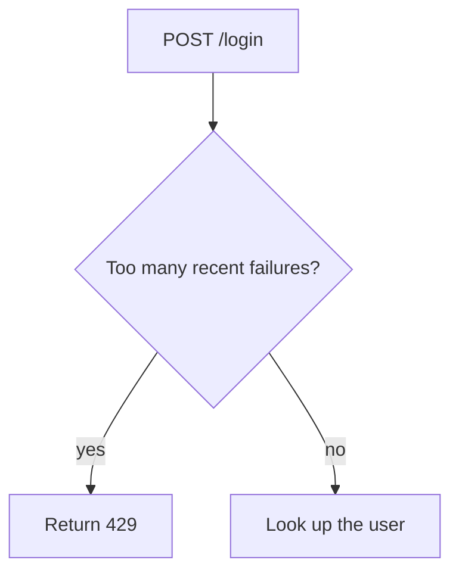

# The overview area

The overview area holds an explanation of a pull request that people read before the diff. prehistoriq shows it on the PR's Overview tab.

Write one Markdown file. Share it with `prehistoriq share overview <file>`, or pipe the Markdown into `prehistoriq share overview -`. The content has no required structure.

## Levels

1. **Plain.** Any Markdown file. It needs a title, from a `title` frontmatter field or the first heading.
2. **Described.** Frontmatter adds a `summary` of one or two sentences. The body may hold Mermaid blocks and link images, SVG files included, with relative paths.

The structured level is for findings only. An overview never needs it.

## Example

````markdown
---
title: Login now checks a rate limit before it looks up the user
summary: Repeated failed logins are rejected early. Allowed logins follow the old path.
---

## How a login flows now

The login handler asks the limiter first. A blocked request never reaches the user table.




The limiter lives in `app/limits.py:15-27`.
````

## Diagrams

Mermaid blocks are fenced with `mermaid`. prehistoriq renders them in the browser, as GitHub does.

- Node ids and participant names are letters, digits and underscores only.
- In a flowchart, put every node label in double quotes.
- In a sequence diagram, write aliases and messages without quotes. Quotes there show up literally.
- Never put a double quote, a backtick, a semicolon or a `#` inside a label or a message.

## Images

- Link each image with a path relative to the Markdown file, as in ``.
- Accepted types are PNG, JPEG, WebP, GIF and SVG.
- At most 20 linked files, each up to 5 MB.
- Every relative link uploads as a file, so link only images. Cite source code as inline code with a path and a line range, as in `app/auth.py:6-18`, never as a link.
- SVG is shown only as an image, so scripts inside it never run.

## Limits

The Markdown body is at most 2 MB.

## Sharing

```bash
prehistoriq share overview out/overview.md
```

`share` attaches the file and its linked images to the current `HEAD` commit, and through it to the PR. It prints one line that says what happened. `-` reads the Markdown from stdin instead. Stdin can't carry images, so `share` refuses a relative image link there. Put an overview with images in its own folder outside the repository, such as one from `mktemp -d`, and share the file.

| Exit | Meaning | What to do |
| --- | --- | --- |
| 0 | Stored, drafted, staged, a duplicate, or skipped because you are not signed in | Relay the line. |
| 1 | A transient failure | Run it once more. |
| 2 | The file breaks this contract | Fix what the line names and share again. |

When your harness does not set a session variable, add `--model <model id>` and `--skill <skill name>` so the version records who wrote it.

Sharing must never fail the user's task. When `prehistoriq` is not on PATH or `share` keeps failing, finish the task and say that sharing was skipped and why.
